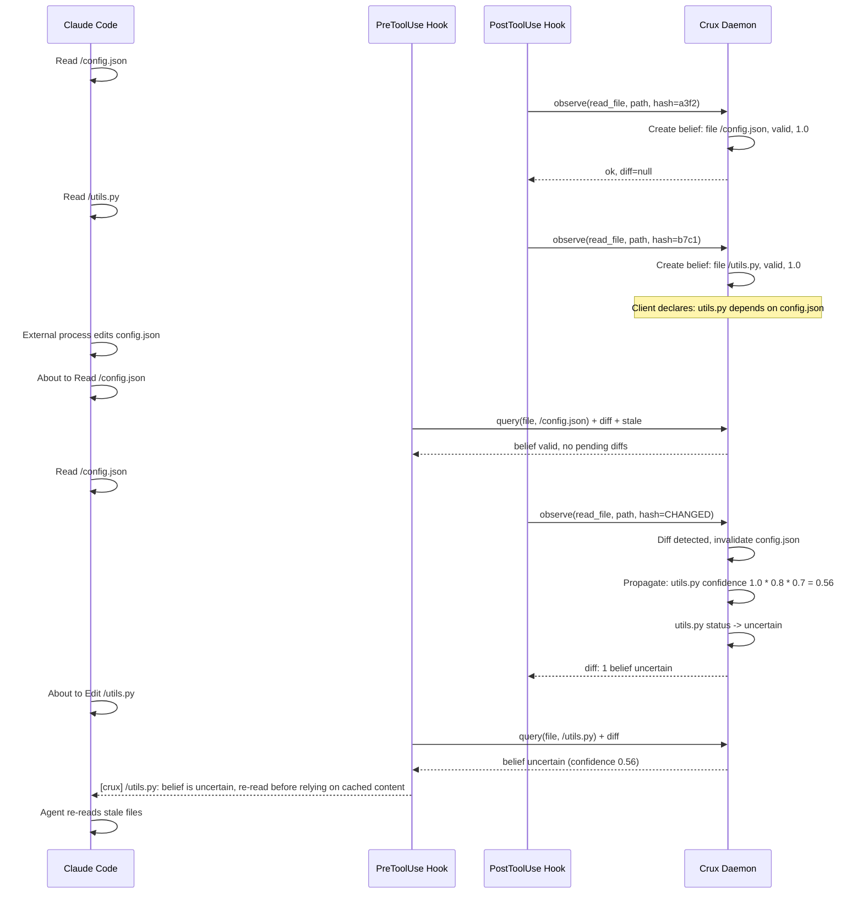
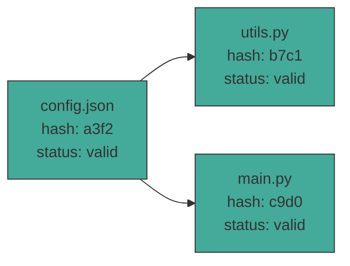
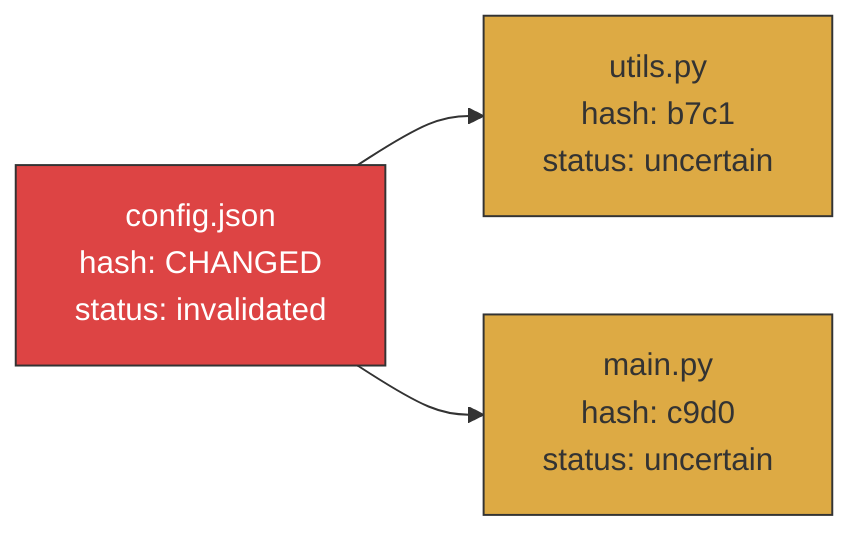
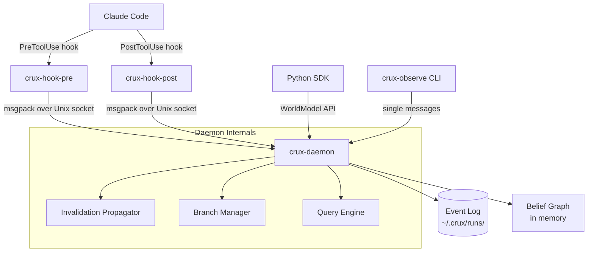

# Crux

Agentic knowledge versioning. `git` for what an AI agent believes about the world.

## Status: shelved

Crux works as built, but I stopped developing it. The core case it was built for, an agent editing a file that changed since it last read it, is already handled inside Claude Code, which tracks reads and refuses an edit to a file modified since the last read. The cases left over were either too small to matter or ones Crux can't see. The details are in [Known limitations](#known-limitations). The code stays up as a reference.

## What it does

An agent reads files, runs commands, checks APIs. Each of those creates a belief -- a versioned snapshot of what the agent thinks reality looks like. When reality changes out from under it, Crux diffs the versions and tells the agent what went stale.

Git tracks file versions across commits. Crux tracks belief versions across agent steps. Git gives you `diff` to see what changed between two points. Crux gives you `query_at` to see what the agent believed at step 5 vs step 20. Git gives you branches for speculative work. Crux gives you the same thing.

The part that goes beyond versioning is the dependency graph. Git doesn't know that `utils.py` depends on `config.json`. Crux does. So when `config.json` changes, it doesn't just tell you that file changed -- it tells you every downstream belief that's now suspect.

Without Crux, an agent that read `config.json` at step 5 and wrote code based on it at step 10 has no way to know that `config.json` was changed at step 8 by a git pull. With Crux, the agent gets told the next time it observes `config.json`, or once the belief's TTL expires. Crux has no file watcher, so it learns about a change only when something re-observes it.

## The use case it was built for

**Session 1: Planning**
- You ask your agent to plan a feature
- Agent reads `src/types.rs`, `src/graph.rs`, understands the codebase
- Agent creates a plan: "Add field X to BeliefNode, update ingest(), update handle_stale()"
- Crux records: plan depends on those file reads

**You go to lunch. Coworker pushes a refactor.**

**Session 2: Implementation**
- New agent starts
- SessionStart hook fires: `plan:add-field-x is stale — file:src/types.rs changed`
- Agent knows immediately: the plan was based on assumptions that no longer hold
- Agent re-reads `src/types.rs`, sees the refactor, decides: "plan still valid" or "need to re-plan"

**Without Crux:**
- Session 2 agent has no idea Session 1 existed
- Implements based on stale context
- Writes code against old structure
- Fails at compile time (if lucky) or introduces subtle bugs (if not)

**What actually happens:** the SessionStart hook doesn't re-hash files, so in Session 2 it can't tell that `src/types.rs` changed. It reports every belief past its TTL as uncertain, which after a lunch break is all of them. Re-hashing tracked files at session start would fix this, and it's the first thing to build if Crux is ever picked back up.

## Philosophy

Crux is built on Peirce's pragmatist epistemology. Beliefs are working hypotheses about reality. They're valid until falsified by a new observation. When falsified, you update and move on. No synthesis, no transcendence. Just ground truth.

An agent reads a file and forms a belief: "config.json contains client_id app-12345." That belief is not a fact. It's a hypothesis that holds until the next observation contradicts it. When someone edits config.json and the agent re-reads it, the old belief is falsified. Crux marks it as such and propagates the doubt to everything that depended on it.

This is the entire model. Observe, believe, falsify, update. The belief graph is not a knowledge base. It's a map of working assumptions, each one carrying a confidence score that decays the further it sits from direct observation. Crux doesn't try to reason about what's true. It just tracks what was observed, when, and what depends on what.

## Components

- **daemon/** -- Rust binary that maintains the belief graph, event log, and query engine. Communicates over a Unix socket with MessagePack framing.
- **sdk/** -- Python package (`crux`) with `WorldModel`, `CruxInterceptor`, and a `crux-observe` CLI.
- **sdk/crux/hooks/** -- Claude Code integration, installed as the `crux-hook-init`, `crux-hook-pre`, and `crux-hook-post` commands. PreToolUse hook surfaces stale beliefs before tool calls. PostToolUse hook registers Read/Write/Edit/Bash as observations. SessionStart hook manages the daemon lifecycle.
- **bench/** -- Benchmark harness with 17 scenarios (8 core + 9 adversarial) that measure agent performance with and without Crux.

## Quick start

### Install

```
pip install crux-sdk
```

Or build from source:

```
make build && make install
```

### Set up Claude Code integration

Run this in your project:

```
crux-setup
```

It writes the SessionStart, PreToolUse, and PostToolUse hooks into `.claude/settings.json`, pointing at the `crux-hook-init`, `crux-hook-pre`, and `crux-hook-post` commands that `pip install crux-sdk` puts on your PATH. It's safe to run more than once. This repo's own `.claude/settings.json` shows the result.

The SessionStart hook starts a single long-lived daemon on `/tmp/crux.sock` (or resumes the existing one) and surfaces stale beliefs from previous sessions. Without a re-hash, "stale" here mostly means past its TTL (see [Known limitations](#known-limitations)). The PreToolUse hook surfaces stale beliefs and pending invalidations before each tool call. The PostToolUse hook registers every file read, write, edit, and shell command as an observation. All sessions share the same daemon, which is how cross-session belief persistence works.

The daemon shuts itself down after 30 minutes of inactivity (configurable via `--idle-timeout`).

That's it. Start a Claude Code session and Crux runs in the background.

### Use from Python directly

```python
from crux import WorldModel, CruxInterceptor

world = WorldModel(socket_path="/tmp/crux.sock")
tools = CruxInterceptor(world)

# These automatically register beliefs
content = tools.read_file("config.json")
tools.write_file("output.py", "print('hello')")
stdout, code = tools.run_shell("git status")
value = tools.read_env("DATABASE_URL")

# Query a belief
belief = world.query("file", path="/absolute/path/to/config.json")
print(belief.status)      # "valid", "uncertain", or "invalidated"
print(belief.confidence)   # 0.0 to 1.0

# Check for pending invalidations
diff = world.diff()
if not diff.is_empty():
    print(f"{len(diff.invalidated)} beliefs invalidated")
    print(f"{len(diff.uncertain)} beliefs uncertain")

# Declare dependencies between beliefs
config = world.query("file", path="/abs/path/config.json")
utils = world.query("file", path="/abs/path/utils.py")
world.add_edge(utils.id, config.id, weight=0.8)
# Now if config.json changes, utils.py automatically becomes uncertain

# Field-level filtering: only cascade when specific payload fields change
world.add_edge(utils.id, config.id, weight=0.8, fields=["hash"])

# Historical queries
past = world.at(step=5)
old_belief = past.query("file", path="/abs/path/config.json")

# Compact context for injection into agent prompts
print(world.to_context())

world.close()
```

### Use the CLI

```
# Initialize a run
crux-observe init --run-id my-session

# Observe a file
crux-observe file /path/to/config.json

# Observe a shell command
crux-observe shell "git status" --exit-code 0 --stdout "On branch main"

# Check world model status
crux-observe status
```

Set `CRUX_SOCKET` to point to a non-default socket path.

### Branching

Crux supports speculative branching for agent exploration:

```python
branch_id = world.branch()
# ... do speculative work ...
world.rollback(branch_id)  # undo everything since branch point
```

Only one branch can be active at a time.

## How it works

1. The daemon maintains an append-only binary event log and an in-memory belief graph.
2. When an observation arrives (file read, shell command, etc.), the daemon extracts an identity key (file path, command string, env var name) and looks up the existing belief.
3. If the payload differs from the stored belief (different hash, different exit code), the belief is marked as invalidated.
4. Invalidation propagates through dependency edges. Confidence decays by `weight * 0.7` per hop. Below 0.6 it becomes "uncertain", below 0.3 it becomes "invalidated".
5. The daemon returns an inline diff on each observe call and accumulates diffs in a pending queue for polling.
6. **Auto-edges:** When using the hooks or interceptor, writes automatically depend on all files read since the last write. No manual `add_edge` calls needed for the common read-then-write pattern.
7. **TTL expiry:** Beliefs expire after a type-specific TTL (shell: 30s, file: 60s, http: 2min, env: 5min). Expired beliefs are marked uncertain on the next query. Per-belief override via `ttl_ms` on observe.
8. **Stability filter:** If a belief oscillates (3+ changes and reverts to a recently-seen value), the cascade is suppressed. Prevents thrashing from triggering unnecessary re-derivation.
9. **Schema evolution:** If a belief's payload keys change (fields added or removed), it always invalidates regardless of the stability filter.
10. **Field-level edges:** Edges can specify which payload fields they depend on. Invalidation only cascades if one of the watched fields actually changed.
11. **GC:** The `gc` IPC message evicts least-recently-read beliefs when the graph exceeds a configurable max size.

## Belief types

| Type | Identity key | Tracked fields |
|------|-------------|----------------|
| file | path | exists, hash, size |
| http_endpoint | url | status_code, auth_valid, response_hash |
| env_var | key | present, value_hash |
| shell_output | command | stdout_hash, exit_code |

## Running tests

```
make test
```

Or manually:

```
cd daemon && cargo test
cd sdk && python -m pytest tests/ -v
```

## Running the benchmark

```
make bench
```

Or manually:

```
cd bench && python runner.py
```

This runs 17 scenarios with and without Crux and computes the Model Coherence Index (MCI). The benchmark uses a scripted agent that simulates realistic tool call patterns. Each task injects a state change mid-run and measures whether the agent recovers.

### MCI scoring

Correctness is binary: each task has a test suite, and the agent either passes or fails it. No LLM-as-judge subjectivity.

```python
if crux.tests_pass and not baseline.tests_pass:
    correctness = +1.0  # Crux fixed it
elif not crux.tests_pass and baseline.tests_pass:
    correctness = -1.0  # Crux broke it
else:
    correctness = 0.0   # Same outcome

token_ratio = crux.tokens / baseline.tokens

if correctness > 0:
    mci = correctness * (1 - overhead_penalty)  # Can't score +1 by burning 3x tokens
elif correctness < 0:
    mci = -1.0
else:
    mci = efficiency_delta  # Same correctness → score based on token cost
```

The overhead penalty keeps adversarial scenarios honest: even if Crux eventually gets the right answer, burning extra tokens on false cascades scores negative.

The benchmark includes adversarial scenarios that show where Crux hurts or can't help:

| Scenario | MCI | What it tests |
|---|---|---|
| task_01-08 | +0.5 to +0.9 | Core value prop: drift detection, crash recovery |
| a1: Static overhead | 0.0 | Minimum tax on simple tasks |
| a3: False cascade | -0.57 | Cost of coarse-grained hashing |
| a4: Thrashing | -1.0 | Oscillating beliefs without damping |
| b1: Semantic equivalence | -0.32 | Hash differs but meaning is identical |
| b4: Latent dependency | -0.37 | Semantic dependencies invisible to graph |
| b5: Stale plan | -0.10 | Plans aren't first-class beliefs |

Overall: Crux MCI 0.882, baseline 0.353, improvement +0.529.

**Read these numbers with care.** The agent is a script I wrote, running tasks I wrote. It checks Crux's warnings because it was programmed to, so the score shows the scripts behave as designed, not that a real model does better with Crux. A real evaluation would run an actual LLM agent on the same tasks with and without the hooks.

## Known limitations

- **No change detection between observations.** There's no file watcher, so a change is caught only when the file is observed again or its TTL runs out.
- **Session-start warnings are mostly TTL noise.** Files aren't re-hashed at session start, so after a break almost every belief shows up as uncertain. Agents learn to ignore noisy warnings.
- **The default auto-edge doesn't cascade.** Hook-created edges use weight 0.9, so one hop gives 1.0 × 0.9 × 0.7 = 0.63, which is above the 0.6 cut-off for uncertain. The dependent belief stays valid. Uncertain beliefs also don't propagate further; only invalidated ones do.
- **The decay constants are arbitrary.** The 0.7 decay and the 0.6 / 0.3 thresholds were picked, not measured.
- **Overlap with Claude Code.** Within a session, Claude Code already blocks edits to files changed since they were read, which covers Crux's main demo.
- **Shared state.** All sessions share one daemon on `/tmp/crux.sock`, and only one branch can be active at a time.

## Architecture



### Belief graph



When config.json changes:



### Component layout



The event log survives process crashes (fsync on every write). On restart, the daemon replays the log to reconstruct the belief graph.
